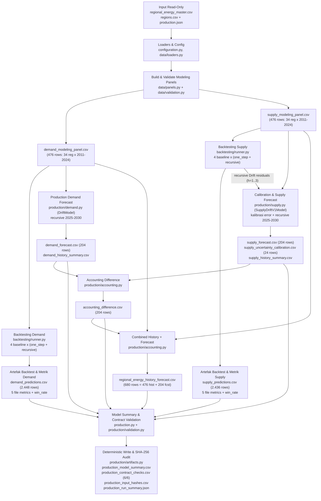

# Laporan Pemetaan & Audit Kritis Pipeline Forecasting ECADIN

- **Proyek**: `ECADIN_Project_Clean`
- **Cakupan Data & Horizon**: Historis `2011–2024` (14 tahun) • Forecast Produksi `2025–2030` (6 tahun) • `34` Provinsi Harmonisasi (`is_model_region = True`)
- **Konfigurasi Produksi**: `configs/forecasting/production.json` (`schema_version = "1.0"`, `pipeline_id = "ecadin_production_forecasting_v1"`)
- **Status Kontrak Saat Ini**: `6/6 PASSED` (`production_contract_checks.csv`) • Integritas Hash: `3/3` input & `24/24` output CSV cocok (`0` mismatch terhadap `production_run_summary.json`)

---

## Ringkasan Eksekutif

Pipeline forecasting ECADIN dibangun di atas arsitektur modular (`src/ecadin_energy/forecasting/` dan `src/ecadin_energy/pipeline/production.py`) yang memisahkan pemuatan data kanonis, penyusunan panel, strategi backtesting, definisi model, evaluasi, kalibrasi ketidakpastian, perhitungan selisih akuntansi (*accounting difference*), serta penulisan artefak deterministik (CSV `UTF-8`/`LF` + audit SHA-256). Pada kondisi saat ini:

1. **Reproducibility & Determinisme Tinggi**: Seluruh 24 output CSV dan 3 file input terverifikasi identik terhadap hash SHA-256 yang tercatat di `production_input_hashes.csv` dan `production_run_summary.json`. Data master kanonis (`regional_energy_master.csv`) bersifat *immutable*.
2. **Evaluasi Backtest Bersih dari Leakage Aktif**: Untuk konfigurasi origin saat ini (`2018–2023`), data aktual masa depan tidak masuk ke histori pelatihan model, dan tahun interpolasi `2016` dikecualikan dari `validation_eligible`.
3. **Temuan Audit Penting**: Meskipun kontrak struktural lulus `6/6`, audit mendalam menemukan **4 temuan `[Kritis]`** (kesalahan *skip* pada *recursive backtest* saat target hilang, penyebut MASE pada gap tahun, kalibrasi interval supply bucket `small` yang membengkak 43×–1.007× akibat migrasi rezim 2021 & sampel nasional `n=4`, serta *hardcode* ekspektasi baris pada validator), **6 temuan `[Disarankan]`** terkait metodologi seri pendek, penanganan *structural break* 2021, inkonsistensi konfigurasi/terminologi, serta **2 temuan `[Opsional]`** terkait kebersihan struktur kode dan cakupan tes kontrak.

### Rekap Jumlah Temuan Audit Berdasarkan Prioritas

| Prioritas | Kode Temuan | Jumlah | Fokus Utama Temuan |
| :--- | :--- | :---: | :--- |
| **`[Kritis]`** | `K-1` s.d. `K-4` | **4** | Bug/celah logika pada `recursive.py` saat target hilang (`YO` 2020), penyebut `mase_scale()` pada tahun tidak konsekutif, kontaminasi kalibrasi ketidakpastian supply (`small` & `national`), dan *hardcode* baris di validator produksi |
| **`[Disarankan]`** | `D-1` s.d. `D-6` | **6** | Guard interpolasi 2016 pra-split, pemanfaatan `data_quality_flags.csv` untuk *regime shift* 2021 & anomali `KR` 2020, keterbatasan `DriftModel` 2-titik (terutama supply `JI` & `h=4..6`), pembobotan *win rate*, terminologi `surplus/defisit` vs disclaimer, serta inkonsistensi config/sort/hash check |
| **`[Opsional]`** | `O-1` s.d. `O-2` | **2** | 5 subfolder kosong duplikat & *dead code* (`splits.py`, `lags.py`, `drift_v1.py`, simbol tak terpakai) serta cakupan minimal pada `test_forecasting_output_contract.py` |
| **Total** | | **12** | **Seluruh temuan diaudit tanpa memodifikasi kode sumber/output** |

---

## Bagian 1: Alur Pipeline Forecasting End-to-End

### 1.1 Entrypoint, Orkestrasi & Diagram Alur

Pipeline dapat dijalankan melalui CLI terpadu (`python scripts/ecadin.py forecast build` / `forecast validate` di `src/ecadin_energy/cli.py`) maupun skrip khusus `scripts/run_production_forecast.py` dan `scripts/validate_production_forecast.py`. Orkestrasi utama berada pada `run_production_pipeline()` di `src/ecadin_energy/pipeline/production.py` dan `validate_production_pipeline()` di `src/ecadin_energy/pipeline/validation.py`.

**Enam tahap eksekusi berurutan di `run_production_pipeline()` (`src/ecadin_energy/pipeline/production.py`):**
1. **Konfigurasi & Pemuatan Input** (`forecasting/configuration.py`, `forecasting/data/loaders.py`): Memvalidasi `configs/forecasting/production.json` (`allow_silent_fill` wajib `false`), membaca `data/processed/master/regional_energy_master.csv`, dan memfilter `data/reference/regions.csv` ke `34` provinsi (`is_model_region = True`) berurutan menurut `modeling_order`.
2. **Konstruksi & Validasi Panel Modeling** (`forecasting/data/panels.py`, `forecasting/data/validation.py`): Membentuk `demand_modeling_panel.csv` (`476` baris) dan `supply_modeling_panel.csv` (`476` baris) di `data/processed/modeling/`.
3. **Backtesting & Evaluasi Komparatif** (`forecasting/backtesting/runner.py`, `strategies/`, `evaluation/`): Mengevaluasi 4 model baseline pada `rolling_one_step` dan `recursive_multi_step`, menghasilkan `demand_predictions.csv` (`2.448` baris), `supply_predictions.csv` (`2.436` baris), serta `12` file metrik/win-rate di `outputs/production/metrics/`.
4. **Inferensi Produksi 2025–2030 & Kalibrasi Supply** (`forecasting/production/demand.py`, `forecasting/production/supply.py`): Menghasilkan `demand_forecast.csv` (`204` baris), `supply_forecast.csv` (`204` baris), `supply_uncertainty_calibration.csv` (`24` baris), dan ringkasan histori per provinsi (`34` baris masing-masing).
5. **Accounting Difference & Combined Panel** (`forecasting/production/accounting.py`): Menghasilkan `accounting_difference.csv` (`204` baris) dan `regional_energy_history_forecast.csv` (`680` baris = `476` historis + `204` forecast).
6. **Validasi Kontrak & Penulisan Deterministik** (`forecasting/production/validation.py`, `forecasting/production/artifacts.py`): Menjalankan `validate_production_frames()` (`6/6` kontrak), menulis 24 CSV secara deterministik (`UTF-8`, `lineterminator="\n"`), mencatat hash input (`production_input_hashes.csv`), dan menerbitkan `production_run_summary.json` (total `25` artefak produksi + `2` panel modeling).

### 1.2 Panel Modeling & Kebijakan Missing Data

Panel disusun di `src/ecadin_energy/forecasting/data/panels.py` atas grid penuh `34 region x 14 tahun (2011–2024) = 476 baris`:
- **Interpolasi Tahun 2016 (`interpolate_years: [2016]`)**: Karena file BPS 2016 tidak tersedia, hanya tahun 2016 yang diinterpolasi linier `(y[2015] + y[2017]) / 2` pada kolom `training_gwh` (`target_status = "interpolated"`, `is_interpolated_target = True`). Kolom `actual_gwh` dibiarkan `NaN` sehingga `training_eligible = True` tetapi `validation_eligible = False`.
- **Pengecualian Batas Geografis (`KI`, `KU` sebelum `2013`)**: Observasi `KI` (Kalimantan Timur) dan `KU` (Kalimantan Utara) tahun `2011–2012` dikosongkan dari pelatihan (`training_gwh = NaN`, `training_eligible = False`, `validation_eligible = False`) karena pemekaran wilayah; statusnya tercatat `excluded_geography_break` bila nilai sumber ada (`KI` 2011–2012 pada demand & supply; `KU` 2011–2012 pada supply) atau `unavailable` bila memang kosong di sumber (`KU` 2011–2012 pada demand).
- **Missing Lain Tidak Diisi Diam-Diam**: Di luar 2016, kekosongan sumber dipertahankan (`unavailable`), khususnya **DI Yogyakarta (`YO`) supply** pada `2011–2014` dan `2020`.

| Domain | Target Kanonis | Total Baris | `training_rows` | `validation_rows` | `interpolated_rows` | `excluded_geography_rows` | Rincian Baris Non-Layak Training |
| :--- | :--- | :---: | :---: | :---: | :---: | :---: | :--- |
| **Demand** | `distributed_electricity_gwh` | 476 | **472** | **438** | 34 (thn 2016) | 2 | `KI` 2011–2012 (`excluded_geography_break`), `KU` 2011–2012 (`unavailable`) |
| **Supply** | `local_generation_gwh` | 476 | **467** | **433** | 34 (thn 2016) | 4 | `KI` & `KU` 2011–2012 (`excluded_geography_break`), `YO` 2011–2014 & 2020 (`unavailable`) |

### 1.3 Skema Backtesting, Strategi Prediksi, dan Fitur Lag

#### A. Skema Backtesting (`configs/forecasting/production.json` & `backtesting/runner.py`)
Evaluasi dilakukan per region menggunakan *expanding window* (training memakai `training_gwh` dengan `year <= origin_year` dan `training_eligible == True`; evaluasi membandingkan `prediction_gwh` terhadap `actual_gwh` hanya saat `validation_eligible == True`):
- **`rolling_one_step`**: `target_years = [2019, 2020, 2021, 2022, 2023, 2024]` (`origin_year = target_year - 1`, `horizon = 1`).
  - Demand: `34 x 6 = 204` kasus/model (`816` total). Supply: `204 - 1 = 203` kasus/model (`812` total; minus `YO` 2020).
- **`recursive_multi_step`**: `origins = [2018, 2019, 2020, 2021]`, `max_horizon = 3` (mencakup target `2019–2024`).
  - Demand: `34 x 4 x 3 = 408` kasus/model (`1.632` total). Supply: `408 - 2 = 406` kasus/model (`1.624` total; minus `YO` 2020 pada `(origin=2018, h=2)` dan `(origin=2019, h=1)`).
- **Total Baris Prediksi Backtest**: Demand `816 + 1.632 = 2.448` baris; Supply `812 + 1.624 = 2.436` baris.

#### B. Perbandingan Strategi `one_step` vs `recursive`

| Dimensi | `rolling_one_step` (`strategies/one_step.py`) | `recursive_multi_step` (`strategies/recursive.py`) |
| :--- | :--- | :--- |
| **Sumber histori langkah berikutnya** | Selalu mengambil histori observasi/training asli hingga `target_year - 1` via `history_at_origin()`. | Mulai dari `base_history` hingga `origin_year`; untuk `h >= 2`, prediksi ter-clip ditambahkan ke `recursive_history` (observasi masa depan tidak pernah dipakai). |
| **Penyebut skala MASE** | Dihitung dari `history_at_origin(region, target_year - 1)` (`mean(|diff(y)|)`). | Tetap menggunakan `scale_history = base_history` hingga `origin_year` (tidak terpengaruh prediksi rekursif). |
| **Non-negativity clipping** | `clip_nonnegative()` (`max(0.0, raw)`) diterapkan saat membentuk `ForecastRecord`. | `clip_nonnegative()` diterapkan sebelum nilai di-*append* ke `recursive_history`. |
| **Peran di produksi** | Hanya untuk evaluasi backtesting. | `recursive_forecast_without_actuals()` dipakai memproduksi forecast `2025–2030` (`origin = 2024`, `horizon = 1..6`). |

#### C. Fitur Lag (`src/ecadin_energy/forecasting/features/lags.py`)
Modul `lags.py` menyediakan `build_lag_features()` dan `build_supervised_lag_frame()` yang menghasilkan fitur `lag_1_gwh`, `lag_2_gwh`, `lag_3_gwh` (default `lags=(1, 2, 3)`), `rolling_mean_3_gwh` (ketat mensyaratkan 3 observasi lengkap `[t-3, t-1]`), `feature_origin_year`, dan `target_year`, disertai validasi anti-leakage (`max(history.year) < target_year`). **Status pemakaian**: modul ini **belum dipakai** oleh keempat model baseline maupun pipeline produksi saat ini (baru diuji pada `tests/unit/test_lag_features.py`); model saat ini mengonsumsi seri `history` (`year`, `target_gwh`) secara langsung.

### 1.4 Daftar Model yang Dibandingkan & Model Pemenang

Kelima kelas model didefinisikan di `src/ecadin_energy/forecasting/models/`:
1. **`naive_lag1`** (`NaiveLag1Model`, `baselines.py`): mengulang nilai observasi terakhir `y_last`.
2. **`drift`** (`DriftModel`, `drift.py`): garis lurus dari observasi pertama ke terakhir, $\hat{y}_t = y_{\text{last}} + \frac{y_{\text{last}} - y_{\text{first}}}{t_{\text{last}} - t_{\text{first}}}(t - t_{\text{last}})$.
3. **`moving_average_3`** (`MovingAverage3Model`, `baselines.py`): rata-rata hingga 3 observasi terakhir.
4. **`average_growth_3`** (`AverageGrowth3Model`, `baselines.py`): CAGR dari hingga 4 observasi positif terakhir (`target_gwh > 0`), diekstrapolasi majemuk $y_{\text{last}}(1 + g)^{t - t_{\text{last}}}$.
5. **`supply_production_drift_v1`** (`SupplyDriftV1Model`, `drift_v1.py`): *subclass* `DriftModel` khusus inferensi produksi supply (tidak ikut daftar `baseline_models`).

| Domain | Protokol (N) | Model | Macro sMAPE (%) | Macro MASE | Micro RMSE (GWh) | Agg. Bias (%) | Win Rate vs Drift |
| :--- | :--- | :--- | ---: | ---: | ---: | ---: | ---: |
| **Demand** | `rolling_one_step` (204) | **`drift` [Produksi]** | **5.83** | **0.894** | **856.92** | **-0.27** | 50.0% (ref) |
| Demand | `rolling_one_step` (204) | `average_growth_3` | 7.09 | 1.055 | 1,207.05 | +0.41 | 45.6% |
| Demand | `rolling_one_step` (204) | `naive_lag1` | 8.93 | 1.423 | 906.28 | -4.16 | 16.7% |
| Demand | `rolling_one_step` (204) | `moving_average_3` | 14.30 | 2.259 | 1,259.03 | -7.95 | 13.2% |
| **Demand** | `recursive_multi_step` (408) | **`drift` [Produksi]** | **8.14** | **1.256** | **1,329.67** | **-0.04** | 50.0% (ref) |
| Demand | `recursive_multi_step` (408) | `average_growth_3` | 11.42 | 1.766 | 2,547.18 | +0.67 | 35.8% |
| Demand | `recursive_multi_step` (408) | `naive_lag1` | 14.61 | 2.367 | 1,433.20 | -7.81 | 16.2% |
| Demand | `recursive_multi_step` (408) | `moving_average_3` | 17.81 | 2.883 | 1,511.93 | -9.90 | 15.9% |
| **Supply** | `rolling_one_step` (203) | `naive_lag1` | **29.35** | 4.687 | **2,056.84** | -3.75 | 40.6% |
| Supply | `rolling_one_step` (203) | **`drift` [Produksi]** | 29.51 | **4.639** | 2,065.43 | **-0.10** | 50.0% (ref) |
| Supply | `rolling_one_step` (203) | `average_growth_3` | 40.64 | 6.732 | 4,257.15 | +9.03 | 34.0% |
| Supply | `rolling_one_step` (203) | `moving_average_3` | 40.85 | 5.461 | 2,808.87 | -7.27 | 36.0% |
| **Supply** | `recursive_multi_step` (406) | `naive_lag1` | **54.83** | **12.000** | **3,669.13** | -7.99 | 48.3% |
| Supply | `recursive_multi_step` (406) | **`drift` [Produksi]** | 56.24 | 12.058 | 3,731.86 | **-0.82** | 50.0% (ref) |
| Supply | `recursive_multi_step` (406) | `moving_average_3` | 61.12 | 12.485 | 3,838.44 | -9.89 | 45.9% |
| Supply | `recursive_multi_step` (406) | `average_growth_3` | 68.49 | 38.247 | 219,751.87 | +148.22 | 35.8% |

- **Pemenang Demand**: **`drift` (`demand_production_drift`)** menang mutlak pada seluruh metrik di kedua protokol.
- **Pemenang Supply & Kontrak Produksi**: Secara `macro_smape_percent` dan `micro_rmse_gwh` keseluruhan, `naive_lag1` unggul tipis atas `drift` (terutama akibat fold 2020→2021). Namun **`drift` (`supply_production_drift_v1`)** tetap dipertahankan sebagai model produksi sesuai kontrak karena: (1) tidak ada auto-promosi challenger, (2) *aggregate bias* hampir nol (`-0.10%` dan `-0.82%` vs `-3.75%` dan `-7.99%`), (3) *win rate* `naive_lag1` vs `drift` tetap di bawah 50% (`40.6%` one-step; `48.3%` recursive), dan (4) setelah *structural break* 2021 berlalu (`fold 2022, 2023, 2024`), one-step `drift` turun ke sMAPE `10.07%`, `7.49%`, `11.28%` dan mengalahkan `naive_lag1` di ketiga tahun tersebut (`11.22%`, `8.36%`, `14.11%`).

### 1.5 Modul Accounting & Kalibrasi Ketidakpastian Supply

#### A. Modul `production/accounting.py`
- **`build_accounting_difference()`** → `outputs/production/accounting/accounting_difference.csv` (`204` baris, 2025–2030): Menggabungkan `demand_forecast` dan `supply_forecast` dengan *outer join* 1:1 per `(region_id, year)`, lalu menghitung `accounting_difference_gwh = supply_gwh - demand_gwh`, `difference_abs_gwh`, `supply_to_demand_ratio`, dan `difference_to_demand_percent` (`NaN` jika `demand_gwh == 0`). Dilengkapi `accounting_disclaimer` bahwa arus listrik antar-wilayah tidak dimodelkan sehingga bukan indikator *shortage*, *surplus*, atau *adequacy*.
- **`build_combined_history_forecast()`** → `outputs/production/combined/regional_energy_history_forecast.csv` (`680` baris): Menggabungkan `476` baris historis (`training_gwh`, termasuk interpolasi 2016) dengan `204` baris forecast. Tepat **`9` baris historis** memiliki `difference_available = False` (`KI` 2011–2012, `KU` 2011–2012, `YO` 2011–2014 & 2020) dan **`0`** pada periode forecast.

#### B. Kalibrasi Ketidakpastian Supply (`production/supply.py` → `supply_uncertainty_calibration.csv`)
Hanya dijalankan untuk domain **supply** menggunakan residual `drift` pada `recursive_multi_step` (`h = 1, 2, 3`):
- Residual dinormalisasi oleh skala tahun origin dengan *floor* `SCALE_FLOOR_GWH = 100.0`: $\text{abs\_scaled\_error} = |\hat{y} - y| / \max(|y_{\text{origin}}|, 100.0)$.
- Dikelompokkan menjadi `regional` (`small` `< 1.000`, `medium` `1.000–<10.000`, `large` `>= 10.000` GWh) dan `national` (`all`, penjumlahan total seluruh provinsi per fold).
- **Horizon 1–3 (`empirical_recursive_drift_backtest`)**: Kuantil empiris linier ke-80% (`q80`) dan ke-95% (`q95`) dengan penegakan monoton $q(h) \ge q(h-1)$ dan $q_{95} \ge q_{80}$.
- **Horizon 4–6 (`sqrt_extrapolation_from_horizon_3`)**: Ekstrapolasi $q(h) = q(3)\cdot\sqrt{h/3}$. Pada `build_supply_forecast()`, hanya baris `regional` yang dipakai untuk membentuk `forecast_lower_{80,95}_gwh = max(0, point - q * scale)` dan `forecast_upper_{80,95}_gwh = point + q * scale`.

| `calibration_scope` | `size_bucket` | `n` (h=1..3) | `q80` (h=1 → h=3) | `q95` (h=1 → h=3) | `q80` (h=6, sqrt) | `q95` (h=6, sqrt) | Emp. Cov. 80 / 95 (h=1..3) |
| :--- | :--- | :---: | :---: | :---: | :---: | :---: | :---: |
| `regional` | `small` (`< 1.000`) | 61 / 61 / 62 | 2.019 → 7.966 | 14.257 → 43.141 | **11.265** | **61.011** | 0.790–0.803 / 0.935–0.951 |
| `regional` | `medium` (`1k–<10k`) | 46 / 46 / 46 | 0.231 → 0.619 | 0.538 → 1.040 | **0.876** | **1.470** | 0.804 / 0.935 |
| `regional` | `large` (`>= 10k`) | 28 / 28 / 28 | 0.185 → 0.397 | 0.302 → 0.439 | **0.561** | **0.620** | 0.786 / 0.929 |
| `national` | `all` | 4 / 4 / 4 | 0.048 → 0.088 | 0.055 → 0.089 | **0.124** | **0.126** | 0.750–1.000 / 0.750–1.000 |

### 1.6 Inventaris Modul/Folder Kosong, Duplikat, & Belum Dipakai Produksi

- **`drift.py` vs `drift_v1.py`**: `drift_v1.py` (10 baris) adalah *subclass* kosong dari `DriftModel` yang hanya menimpa `model_id = "supply_production_drift_v1"` (logika kalibrasi berada di `production/supply.py`). Di `models/registry.py`, `supply_production_drift_v1` terdaftar sedangkan `demand_production_drift` tidak terdaftar (`production/demand.py` menginstansiasi `DriftModel()` langsung).
- **5 Subfolder Kosong di `src/ecadin_energy/forecasting/`**: `accounting/`, `common/`, `demand/`, `supply/`, dan `validation/` hanya berisi `__init__.py` (0 byte) dan tidak diimpor; implementasi aktifnya sudah berada di `forecasting/production/` dan `forecasting/data/`.
- **Modul & Simbol Belum Dipakai Produksi**: `backtesting/splits.py` (`BacktestSplit`, `rolling_one_step_splits`, `recursive_splits`, `configured_splits`), `features/lags.py`, `SeriesSpec` & `BacktestSpec` (`contracts.py`), `InsufficientHistoryError` (`exceptions.py`), serta impor `asdict` (`data/panels.py:3`).
- **Folder Kosong Terkait**: `src/ecadin_energy/experiments/` (`demand/`, `supply/`) dan `outputs/production/models/{demand,supply}/.gitkeep` serta `outputs/production/pipeline/.gitkeep`.

---

## Bagian 2: Temuan Audit Kritis & Rekomendasi Perbaikan

### 2.1 Temuan Prioritas `[Kritis]` (4 Temuan)

#### `K-1` `[Kritis]` `strategies/recursive.py`: Melewatkan *step* prediksi saat target hilang (*structural look-ahead*)
- **File Terkait**: `src/ecadin_energy/forecasting/strategies/recursive.py` (`L40-L44`)
- **Temuan Teknis**: Dalam `run_recursive_for_model()`, pengecekan `if not bool(eligible_lookup.get(target_year, False)): continue` dan `if pd.isna(actual): continue` dijalankan **sebelum** memanggil `model.predict_next()` dan meng-*append* hasilnya ke `recursive_history`. Secara metodologis, pada `origin_year`, model tidak boleh mengetahui bahwa observasi masa depan (contoh aktual: `YO` supply tahun `2020`) akan kosong. Pada data saat ini nilai `YO` 2015–2019 kebetulan konstan `0.0` sehingga angka `YO` 2021–2022 tidak berubah, namun pada seri non-konstan atau model berbasis window/lag, melewatkan `h=2` akan menggeser isi `recursive_history` pada `h=3`.
- **Rekomendasi**: Selalu jalankan `predict_next()` → `clip_nonnegative()` → append ke `recursive_history` untuk setiap `horizon = 1..max_horizon`; gunakan validitas `actual` hanya sebagai syarat pencatatan `ForecastRecord`.
- **Dampak Downstream**: **Aman (0 risiko)** terhadap `test_forecasting_output_contract.py` maupun `dashboard/`. Jumlah baris backtest tetap `2.448` / `2.436` dan forecast produksi `2025–2030` tidak berubah.

#### `K-2` `[Kritis]` `evaluation/metrics.py`: `mase_scale()` mengasumsikan tahun berurutan tanpa mengecek selisih tahun
- **File Terkait**: `src/ecadin_energy/forecasting/evaluation/metrics.py` (`L25-L30`)
- **Temuan Teknis**: `mase_scale()` menghitung `np.mean(np.abs(np.diff(values)))` langsung dari array nilai tanpa memverifikasi `np.diff(years) == 1`. Pada `YO` supply (tahun `2020` hilang), transisi `2019 (0.00) -> 2021 (3.32)` dihitung sebagai perubahan 1 tahun padahal rentangnya 2 tahun (`mase_scale = 0.664` pada origin 2021). Selain itu, ketika histori `YO` bernilai `0.0` konstan (origin 2018–2020), `scale = 0` menghasilkan `mase = NaN` (rata-rata MASE `YO` hanya menghitung sebagian fold, sedangkan `smape_percent = 200%` di 2021 tetap masuk agregasi).
- **Rekomendasi**: Hitung selisih penyebut MASE hanya pada pasangan tahun berurutan (`diff(year) == 1`) atau normalisasi per tahun (`|diff(y)| / diff(year)`), serta dokumentasikan jumlah observasi valid untuk `macro_mase`.
- **Dampak Downstream**: **Aman (0 risiko)** terhadap `test_forecasting_output_contract.py` dan `dashboard/` (dashboard tidak membaca/memvalidasi `macro_mase`). Cukup perbarui/tambah unit test di `tests/unit/test_metrics.py`.

#### `K-3` `[Kritis]` `production/supply.py` & `supply_uncertainty_calibration.csv`: Pita ketidakpastian bucket `small` tidak realistis (43×–1.007×) & sampel nasional `n = 4`
- **File Terkait**: `src/ecadin_energy/forecasting/production/supply.py` (`L23-L185`), `outputs/production/forecasts/supply_uncertainty_calibration.csv`, `outputs/production/forecasts/supply_forecast.csv`
- **Temuan Teknis**:
  1. **Kontaminasi *structural break* 2021 + *bucket migration***: Provinsi yang pada `2018–2020` bernilai `< 1.000 GWh` (`LA` 41 GWh → 5.436 GWh, `abs_scaled_error = 56.31`; `SB` `43.96`; `KT` `27.55`; `BE` `17.17`; `KB` `16.53`) menyumbang residual ekstrem ke bucket `small` (`q95(h=6) = 61.011`). Pada 2024 provinsi-provinsi tersebut sudah naik ke bucket `medium`, sehingga 7 provinsi kecil aktual (`YO`, `MA`, `PB`, `GO`, `MU`, `KU`, `SR`) mewarisi pengali `61.011×`. Akibatnya pada `supply_forecast.csv` 2030: `YO` (`6.07 GWh`) mendapat `upper_95 = 6.107,16 GWh` (**1.007×** prediksi titik), `MA` (`1.107 GWh`) mendapat `56.418 GWh` (**50.9×**), `PB` (**49.3×**), `GO` (**46.5×**), `MU` (**45.5×**), `KU` (**43.7×**), dan `SR` (**43.4×**).
  2. **Sampel `national/all` hanya `n = 4` per horizon**: Mengestimasi kuantil ke-95 dari 4 titik tidak stabil (coverage in-sample `q95` di `h=1,2` hanya `0.75`).
  3. **Simetri & ekstrapolasi $\sqrt{h/3}$**: Error supply miring kanan (*right-skewed*), namun pita simetris terpotong di `0.0`, dan deviasi model tren/drift tumbuh sebanding $O(h)$, bukan $\sqrt{h}$.
- **Rekomendasi**: Kalibrasi interval pada skala log/asimetris (kuantil bawah & atas terpisah), isolasi residual *regime break* 2021 atau pakai residual pasca-2021 agar *bucket migration* tidak meracuni provinsi kecil, dan jangan menerbitkan `q95` nasional dari `n = 4`.
- **Dampak Downstream**: **Aman (0 risiko)** terhadap `test_forecasting_output_contract.py` (hanya cek duplikat, 34 region, dan tahun 2025–2030) maupun `dashboard/` (`dashboard/loaders.py` tidak membaca `supply_forecast.csv` atau `supply_uncertainty_calibration.csv`, dan `regional_uncertainty_display_allowed = false`).

#### `K-4` `[Kritis]` `production/validation.py`: Kontrak jumlah baris di-hardcode (`2448`, `2436`, `9`) terlepas dari `ProductionConfig`
- **File Terkait**: `src/ecadin_energy/forecasting/production/validation.py` (`L67-L168`)
- **Temuan Teknis**: `expected_demand_predictions = 2448`, `expected_supply_predictions = 2436`, dan `historical_missing == 9` ditulis sebagai konstanta *hardcoded*. Setiap perubahan konfigurasi (`baseline_models`, `one_step_target_years`, `recursive_origins`, `recursive_max_horizon`, atau perpanjangan tahun historis) akan langsung melempar `ContractError` meskipun output konsisten dengan config.
- **Rekomendasi**: Turunkan ekspektasi jumlah baris secara dinamis dari `config` dan kelayakan baris aktual pada panel (atau pisahkan *strict baseline-2024 snapshot check* dari *config-driven contract validator*).
- **Dampak Downstream**: **Aman (0 risiko)** selama `configs/forecasting/production.json` saat ini tetap digunakan; seluruh 6 cek tetap `PASSED`.

---

### 2.2 Temuan Prioritas `[Disarankan]` (6 Temuan)

#### `D-1` `[Disarankan]` `data/panels.py`: Interpolasi 2016 dilakukan global sebelum split backtest
- **File Terkait**: `src/ecadin_energy/forecasting/data/panels.py` (`L33-L46`, `L130-L148`), `src/ecadin_energy/forecasting/configuration.py`
- **Temuan Teknis**: Interpolasi `(y[2015] + y[2017]) / 2` dilakukan di panel awal. Saat ini aman dari leakage karena seluruh origin backtest adalah `2018–2023`, namun jika suatu saat origin dimundurkan `<= 2016`, nilai `2017` akan bocor ke training. Selain itu, interpolasi linier ini menutupi lonjakan struktural `2015 -> 2017` (mis. demand `BT` `8.575 -> 22.558 GWh`, supply `JT` `25.690 -> 39.580 GWh`).
- **Rekomendasi**: Tambahkan *config guard* `min(origin_years) > max(interpolate_years) + 1` di `validate_production_config()`, atau hitung interpolasi di dalam `history_at_origin()`.
- **Dampak Downstream**: **Aman (0 risiko)** selama `2016` tetap ditandai `is_interpolated_target = True` dan `validation_eligible = False`.

#### `D-2` `[Disarankan]` `data_quality_flags.csv`: Flag lonjakan struktural tidak dibaca forecasting (*regime shift* supply 2021 & anomali demand `KR` 2020)
- **File Terkait**: `data/processed/master/data_quality_flags.csv` (`L38-L44`, `L86-L110`), `src/ecadin_energy/forecasting/data/loaders.py`
- **Temuan Teknis**: `data_quality_flags.csv` sudah mendokumentasikan `warning` `large_consecutive_yoy_change` (`retained_as_reported`), tetapi pipeline forecasting tidak membacanya. Pada domain **supply tahun 2021**, **17 dari 34 provinsi** melonjak `> +75%` serentak (`LA` `41.55 -> 5.436 GWh` [+12.983%], `KT` `49.85 -> 2.632 GWh` [+5.179%], `SG` `25.73 -> 1.182 GWh` [+4.493%], `BE` +1.595%, `KB` +1.358%, `JA` +753%, `AC` +612%, `RI` +602%, `GO` +500%, `SB` +363%, `SR` `0 -> 249 GWh`), berkorelasi dengan flag serupa di `installed_capacity_mw` (indikasi kuat perubahan cakupan pencatatan BPS 2021). Di domain **demand**, `KR` turun `-73.5%` satu tahun di `2020` (`3.346 -> 888 -> 3.479 GWh`).
- **Rekomendasi**: Tetap pertahankan nilai sumber kanonis tanpa modifikasi diam-diam, namun laporkan metrik evaluasi terpisah pra- vs pasca-2021 (supply) dan analisis sensitivitas outlier `KR` 2020 (demand) di laporan KP.
- **Dampak Downstream**: **Aman (0 risiko)** bila hanya ditambahkan sebagai pelaporan metrik terstratifikasi; **berisiko memecahkan kontrak** jika membuang/mengubah nilai historis di panel atau `combined`.

#### `D-3` `[Disarankan]` `models/drift.py` & `baselines.py`: Keterbatasan struktural `DriftModel` 2-titik pada seri pendek & ketiadaan evaluasi `h = 4..6`
- **File Terkait**: `src/ecadin_energy/forecasting/models/drift.py`, `src/ecadin_energy/forecasting/models/baselines.py`, `outputs/production/metrics/*_metrics_by_{region,fold,horizon}.csv`
- **Temuan Teknis**:
  1. **Sensitif terhadap 2 titik ujung (`2011` & `2024`)**: `DriftModel` mengabaikan 12 observasi tengah. Akibatnya, supply **Jawa Timur (`JI`)** mendapat slope `-375.88 GWh/tahun` (memproyeksikan penurunan terus-menerus ke `44.657 GWh` di 2030 karena `2011=51.799 > 2024=46.913`), sementara demand **Banten (`BT`)** memiliki slope terlalu curam (`+1.572 GWh/tahun`, bias `+8.39%`).
  2. **Konsentrasi error ekstrem pada wilayah tertentu**: Pada *demand* recursive, error terkonsentrasi di `KR` (`sMAPE 59.4%`), `KU` (`27.7%`), `BA` (`17.4%`), `MU` (`17.2%`, bias `-17.7%`), dan `RI` (`16.8%`, bias `-16.6%`). Pada *supply* recursive, 12 provinsi terdampak *break* 2021 memiliki `sMAPE 81%–149%` (`MASE` hingga `102.4` di `BE` dan `100.2` di `LA`).
  3. **Temuan positif pasca-2021 (layak sorot di laporan KP)**: Pada fold `2022, 2023, 2024` (setelah rezim 2021 stabil), one-step `drift` supply membaik ke sMAPE **`10.07%`**, **`7.49%`**, dan **`11.28%`**, mengalahkan `naive_lag1` di ketiga tahun (`11.22%`, `8.36%`, `14.11%`).
  4. **Celah horizon & ketidakstabilan pembanding**: Evaluasi rekursif berhenti di `h = 3` (sMAPE supply `drift` sudah naik `39.8% -> 60.1% -> 68.5%`), sedangkan produksi memproyeksikan hingga `h = 6` (`2030`). Sementara `AverageGrowth3Model` meledak pada supply `h = 3` (`RMSE 379.050 GWh`; `LA` `1.275.649 GWh`).
- **Rekomendasi**: Bangun eksperimen challenger di `src/ecadin_energy/experiments/` dengan metode yang sesuai seri tahunan pendek: **Holt's Damped Trend / ETS**, **OLS / Recent-Window Drift** (mis. window 4–5 tahun pasca-break), dan **Ridge/Theta** memanfaatkan `features/lags.py`; tambahkan *damping/cap* CAGR pada `AverageGrowth3Model`.
- **Dampak Downstream**: **Aman** jika dijalankan di `experiments/`. **⚠️ BERISIKO MEMECAHKAN** `dashboard/validation.py` (`production_model_contract` di `L52`) apabila model produksi diubah tanpa mengizinkan ID model baru di konfigurasi & kontrak dashboard.

#### `D-4` `[Disarankan]` `evaluation/challenger.py`: Pembobotan *win rate* tidak seragam terhadap tahun target & skala provinsi
- **File Terkait**: `src/ecadin_energy/forecasting/evaluation/challenger.py` (`L35-L60`)
- **Temuan Teknis**: Pada `recursive_multi_step`, tahun `2021` terhitung `3x` (origin `2018, 2019, 2020`) sedangkan `2019` dan `2024` hanya `1x`, dan provinsi kecil seperti `YO` (`3.6 GWh`) berbobot sama dengan `JB` (`61.637 GWh`). Nilai `tie = 0.5` juga membuat baris referensi (`drift`) melaporkan `win_rate_vs_reference = 0.5`.
- **Rekomendasi**: Tambahkan laporan *win rate* teragregasi per `horizon` (`h=1,2,3`), per `forecast_year`, serta *error-weighted win rate* (atau pasca-2021) sebagai pelengkap.
- **Dampak Downstream**: **Aman (0 risiko)** — `*_win_rate_vs_drift.csv` tidak dibaca oleh test kontrak maupun dashboard.

#### `D-5` `[Disarankan]` `production/accounting.py` vs `dashboard/`: Kontradiksi terminologi *surplus/defisit* & distorsi YoY nasional
- **File Terkait**: `src/ecadin_energy/forecasting/production/accounting.py` (`L48-L138`), `src/ecadin_energy/dashboard/region_detail.py` (`L10-L21`), `src/ecadin_energy/dashboard/national_overview.py` (`L7-L36`)
- **Temuan Teknis**: Secara matematis `accounting.py` akurat (`0` pembagian nol, total nasional 2024→2025 mulus). Namun disclaimer melarang interpretasi *shortage/surplus/adequacy*, sedangkan `region_detail.py` mengklasifikasikan rasio ke `"surplus_tinggi"`, `"surplus_moderat"`, `"defisit_moderat"`, dan `"defisit_tinggi"`. Selain itu, di `national_overview.py`, pertumbuhan YoY nasional historis pada tahun transisi cakupan provinsi (`31 -> 33 -> 34 -> 33 -> 34`) mencampur pertumbuhan energi dengan penambahan/pengurangan provinsi (`KI`/`KU`/`YO`).
- **Rekomendasi**: Jelaskan pembedaan kode internal `gap_category` vs makna non-adequacy di dokumentasi/laporan KP dan beri penanda *partial overlap* pada YoY nasional, tanpa mengubah kode kategori yang sudah terkontrak di frontend/test.
- **Dampak Downstream**: **⚠️ BERISIKO MEMECAHKAN** — mengubah perlakuan 2016 pada `combined` melanggar `completeness_contract` (`671/9`) di `dashboard/validation.py#L49`, dan mengubah string `gap_category` melanggar `test_dashboard_region_detail.py` serta `category_contract`.

#### `D-6` `[Disarankan]` `configs/forecasting/production.json` & `pipeline/production.py`: Inkonsistensi config, urutan sort, dan celah verifikasi hash
- **File Terkait**: `configs/forecasting/production.json`, `src/ecadin_energy/pipeline/production.py` (`L115-L121`), `src/ecadin_energy/forecasting/production/{demand,supply}.py`, `src/ecadin_energy/pipeline/validation.py`
- **Temuan Teknis**:
  1. `output_value_column` (`forecast_distributed_electricity_gwh`, `forecast_local_generation_gwh`) di `production.json` tidak pernah dipakai; CSV output tetap memakai `forecast_gwh`.
  2. Urutan baris tidak seragam: `demand_forecast.csv` diurutkan `["modeling_order", "year"]`, sedangkan `supply_forecast.csv` diurutkan `["year", "modeling_order"]`.
  3. `_model_summary()` meng-hardcode `"drift"` dan `"Drift"` alih-alih membaca `config.reference_baseline` / `model_label`.
  4. `demand_forecast.csv` menulis `model_version = "demand_production_drift_v1"`, berbeda dari `production_model_id = "demand_production_drift"`.
  5. `validate_written_outputs()` belum memverifikasi kecocokan SHA-256 terhadap `production_input_hashes.csv` & `production_run_summary.json` (dan JSON ringkasan masih menyimpan path absolut mesin lokal `D:\ECADIN_Project_Clean` serta timestamp UTC).
- **Rekomendasi**: Tambahkan verifikasi SHA-256 di validator, baca metadata dari `config` di `_model_summary()`, seragamkan sort `supply_forecast.csv` menjadi `["modeling_order", "year"]`, serta normalkan path relatif di JSON summary. Pertahankan nama kolom `forecast_gwh` jika tidak ingin mengubah `accounting.py`.
- **Dampak Downstream**: **Aman** terhadap dashboard dan `test_forecasting_output_contract.py` (penyeragaman sort hanya mengubah hash file `supply_forecast.csv`, bukan key atau agregasi).

---

### 2.3 Temuan Prioritas `[Opsional]` (2 Temuan)

#### `O-1` `[Opsional]` Kebersihan struktur modul, 5 folder kosong, dan *dead code*
- **File Terkait**: `src/ecadin_energy/forecasting/{accounting,common,demand,supply,validation}/__init__.py`, `models/drift_v1.py`, `models/registry.py`, `backtesting/splits.py`, `features/lags.py`, `contracts.py`, `exceptions.py`, `data/panels.py#L3`, `src/ecadin_energy/experiments/`
- **Temuan Teknis**: Terdapat 5 subfolder kosong duplikat nama di `forecasting/`, *wrapper* tipis `drift_v1.py` (10 baris) yang asimetris terhadap `demand` di `registry.py`, impor mati `asdict` di `data/panels.py`, serta modul/simbol yang baru dipakai di unit test (`splits.py`, `lags.py`, `SeriesSpec`, `BacktestSpec`, `InsufficientHistoryError`).
- **Rekomendasi**: Hapus 5 subfolder kosong dan impor mati; gunakan `splits.py` langsung di `backtesting/runner.py` sebagai *single source of truth*. Pertahankan `experiments/` bila disiapkan untuk riset challenger berikutnya.
- **Dampak Downstream**: **Aman (0 risiko)** jika `drift_v1.py` **tetap dipertahankan** (atau bila diubah, perbarui serentak `registry.py`, `production/supply.py`, dan `tests/unit/test_drift_models.py`).

#### `O-2` `[Opsional]` `tests/contracts/test_forecasting_output_contract.py`: Cakupan tes kontrak terlalu minim
- **File Terkait**: `tests/contracts/test_forecasting_output_contract.py`, `tests/fixtures/fixture_manifest.json`
- **Temuan Teknis**: Pengujian kontrak saat ini hanya memeriksa duplikat `(region_id, year)`, `34` region, dan tahun `2025–2030` pada file *static fixture*, belum memvalidasi non-negativity, kelengkapan skema kolom, konsistensi `accounting_difference.csv`, maupun batas kewajaran `supply_uncertainty_calibration.csv`.
- **Rekomendasi**: Perbanyak assertions pada tes kontrak tanpa mengubah isi file fixture yang hash-nya dikunci oleh `test_portable_fixture_contract.py`.
- **Dampak Downstream**: **Aman (0 risiko)** terhadap pipeline produksi maupun dashboard.

---

### 2.4 Matriks Ringkasan Dampak Downstream

Sebagai acuan, `src/ecadin_energy/dashboard/loaders.py` **hanya** mengonsumsi 3 artefak forecasting berikut:
1. `outputs/production/combined/regional_energy_history_forecast.csv` (`680` baris, `34` region, `671` complete, `9` historical missing, `0` forecast missing)
2. `outputs/production/metrics/production_model_summary.csv` (`2` model aktif dengan `production_model_id` tepat `{"demand_production_drift", "supply_production_drift_v1"}`)
3. `outputs/production/reports/production_contract_checks.csv` (semua baris `passed == True`)

Dashboard **tidak membaca** `demand_forecast.csv`, `supply_forecast.csv`, `supply_uncertainty_calibration.csv`, maupun `outputs/production/backtests/*`.

| Kode | Prioritas | Ringkasan Perbaikan | Dampak ke `test_forecasting_output_contract.py` | Dampak ke `src/ecadin_energy/dashboard/` & Kontrak Lain |
| :---: | :---: | :--- | :--- | :--- |
| `K-1` | `[Kritis]` | Selalu append prediksi di `strategies/recursive.py` saat target hilang | **Aman** (0 risiko) | **Aman** — jumlah baris backtest & forecast produksi tidak berubah |
| `K-2` | `[Kritis]` | Cek `diff(year) == 1` pada `mase_scale()` di `evaluation/metrics.py` | **Aman** (0 risiko) | **Aman** — dashboard tidak memvalidasi `macro_mase`; tambah test di `test_metrics.py` |
| `K-3` | `[Kritis]` | Perbaiki metodologi `supply_uncertainty_calibration.csv` (break 2021, *bucket migration*, `n=4`) | **Aman** (0 risiko) | **Aman** — file kalibrasi & interval tidak dikonsumsi dashboard (`regional_uncertainty_display_allowed = false`) |
| `K-4` | `[Kritis]` | Hitung ekspektasi baris di `production/validation.py` dinamis dari `ProductionConfig` | **Aman** (0 risiko) | **Aman** — kontrak `6/6 PASSED` tetap terpenuhi pada config default |
| `D-1` | `[Disarankan]` | Tambah guard `origin > max(interpolate_years) + 1` | **Aman** (0 risiko) | **Aman** — validasi konfigurasi defensif |
| `D-2` | `[Disarankan]` | Stratifikasi metrik pra/pasca-2021 & sensitivitas `KR` 2020 | **Aman** (0 risiko) | **Aman** jika hanya pelaporan; **⚠️ Berisiko** jika mengubah nilai/baris panel historis |
| `D-3` | `[Disarankan]` | Eksperimen challenger (`ETS`/`OLS`/`Ridge`) di `experiments/` & cap `AverageGrowth3` | **Aman** (0 risiko) | **Aman** di `experiments/`; **⚠️ Berisiko** jika mengganti `production_model_id` di `dashboard/validation.py#L52` |
| `D-4` | `[Disarankan]` | Tambah rincian *win rate* per horizon / tahun / pasca-2021 | **Aman** (0 risiko) | **Aman** — `win_rate_vs_drift.csv` tidak dibaca dashboard |
| `D-5` | `[Disarankan]` | Dokumentasikan kode `gap_category` vs non-adequacy & tandai *partial overlap* YoY | **Aman** | **⚠️ Berisiko memecahkan** `completeness_contract` (`671/9`) & `category_contract` jika nilai/label `combined`/`gap_category` diubah |
| `D-6` | `[Disarankan]` | Verifikasi hash di validator, pakai `config` di `_model_summary()`, samakan sort `supply_forecast.csv` | **Aman** (pertahankan kolom `forecast_gwh`) | **Aman** — hanya mengubah hash `supply_forecast.csv`; tidak menyentuh input dashboard |
| `O-1` | `[Opsional]` | Hapus 5 subfolder kosong & impor mati; integrasikan `splits.py` | **Aman** (0 risiko) | **Aman** selama `drift_v1.py` dipertahankan atau disinkronkan dengan registry & test |
| `O-2` | `[Opsional]` | Tambah assertions di `test_forecasting_output_contract.py` | Memperkuat test | **Aman** selama file `tests/fixtures/` tetap identik dengan `fixture_manifest.json` |
